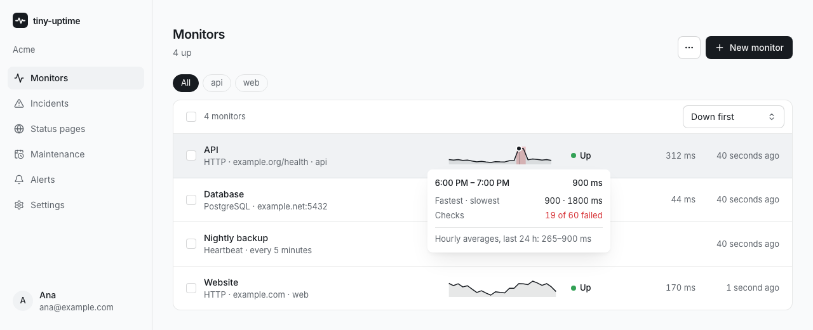
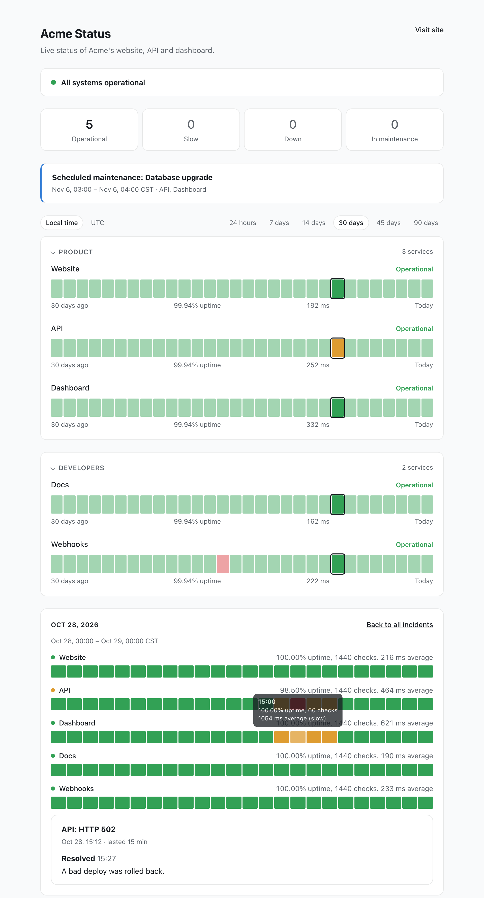

<div align="center">


# tiny-uptime

**Uptime monitoring and status pages that run entirely on Cloudflare's free plan.**

One Worker and Durable Objects with SQLite. No external database, no queue, no servers to keep alive.

[](https://github.com/RobertoVillegas/tiny-uptime/actions/workflows/ci.yml)
[](LICENSE)

[Features](#features) · [Deploy](#deploy) · [API](#rest-api) · [MCP](#mcp) · [Status pages](#status-pages) · [How it works](#how-it-works) · [Develop](#develop)

</div>



## What is tiny-uptime?

tiny-uptime checks your websites, APIs, ports and cron jobs, opens an incident when one goes down, alerts you where you already are, and publishes a status page for your users.

Each workspace is a Durable Object with its own SQLite database. It stores the monitors, runs their checks from an alarm and sends the alerts. Every request stays far below the free plan's 10 ms of CPU, so a few dozen monitors cost nothing to run.

## Features

**Monitoring**

- [x] HTTP with method, headers, body, expected status codes and a keyword that must be present or absent
- [x] [JSON checks](#json-checks): fields of the response that must hold, such as `$.status == ok`
- [x] Redirects followed by hand, keeping the cookies each hop sets
- [x] TCP, DNS records, WebSocket, PostgreSQL, MySQL and Redis handshakes
- [x] Heartbeats for cron jobs and background workers
- [x] Domain registration expiry, MCP servers, EVM and Solana nodes, Minecraft servers
- [x] [Multi-region checks](#multi-region-checks): a run fails only when most regions fail
- [x] Failure and recovery thresholds, slow-response alerts, and dependencies so a downstream outage pages you once
- [x] Check now from the panel, the API or MCP

**Status pages**

- [x] Server-rendered HTML with no JavaScript, in English or Spanish, light, dark or automatic
- [x] Groups of monitors that visitors can fold, and a count of what is up, slow, down or in maintenance
- [x] History from 24 hours to 90 days: a bar per hour up to a week, a bar per day beyond
- [x] Each bar shows its uptime and average response time; slow bars are marked by the monitor's own threshold
- [x] Open a day to see it hour by hour, with the incidents that overlapped it
- [x] Days cut at the page's midnight, times in the visitor's time zone, and a switch to UTC
- [x] RSS feed, public JSON, an SVG status badge and a custom domain
- [x] A history reset that hides old bars and incidents without deleting them



**Incidents and alerts**

- [x] Incidents open and resolve with each monitor; acknowledge them and post public or internal updates
- [x] Declared incidents for things no monitor sees, such as a slow payment provider
- [x] Maintenance windows, one-off or recurring, that silence alerts
- [x] Slack, Discord, Microsoft Teams, Telegram, ntfy, Lark / Feishu, PagerDuty, email and webhooks, with retries
- [x] Each alert links to its incident in the panel
- [x] Reminders while nobody acknowledges an incident, and escalation to other channels

**Panel and automation**

- [x] A chart of the last 24 hours in every monitor row, sorting, tags and bulk pause, resume, delete or alert routing
- [x] Workspaces with owners, editors and viewers
- [x] Sign-in with passkeys, optional TOTP and one-time recovery codes
- [x] [REST API](#rest-api) with API keys
- [x] [MCP server](#mcp) with OAuth, so an agent can manage monitors, incidents and status pages
- [x] JSON import and export, and a [one-step import from OpenUptime](#moving-from-openuptime)

## Why we built it

[Athas](https://athas.mx) ran [OpenUptime](https://github.com/becoolme/openuptime) on Cloudflare Workers, with Postgres on Supabase reached through Hyperdrive. It is a good product, and most of what tiny-uptime does was learned from it. Two things did not fit how we wanted to run it:

- **The database was a second service to keep alive.** A monitor has one job, to be up when other things are down. Ours depended on Supabase and on Hyperdrive's daily query limit, which the free plan kept running into.
- **We wanted something small that is ours.** A codebase one person can read end to end, that costs nothing for a few dozen monitors, and that we can change the day we need something.

OpenUptime remains the reference for features. tiny-uptime sends alerts in OpenUptime's webhook format, names fields the same where it can, and imports an OpenUptime project's monitors with one API key. We also sent a few performance fixes upstream ([#18](https://github.com/becoolme/openuptime/pull/18)–[#22](https://github.com/becoolme/openuptime/pull/22)).

### Which one should you use?

| | tiny-uptime | OpenUptime |
| --- | --- | --- |
| Runs on | One Cloudflare Worker with Durable Objects | Cloudflare Workers with Postgres, or Docker |
| Database | SQLite inside each workspace's Durable Object | Postgres |
| Cost for a few dozen monitors | Cloudflare's free plan | Free plan plus a Postgres host |
| Teams | Workspaces with roles | Workspaces, projects, roles and assignment |
| Hosted version | No | Yes |
| Mobile app | No | iOS, with push notifications |

Pick OpenUptime if you want Postgres, a hosted service, projects within a team or an iOS app. Pick tiny-uptime if you want the smallest thing that runs on Cloudflare alone.

## Deploy

You need a Cloudflare account and [mise](https://mise.jdx.dev), or the Node and pnpm versions in `mise.toml`.

**1. Get the code and sign in**

```bash
git clone https://github.com/RobertoVillegas/tiny-uptime.git && cd tiny-uptime
mise install && pnpm install
pnpm --filter @tiny-uptime/worker exec wrangler login
```

**2. Point the config at your domain**

`apps/worker/wrangler.jsonc` holds Athas's deployment. Change:

- `routes`: your hostname with `"custom_domain": true`, or remove it to stay on `*.workers.dev`.
- `vars.APP_URL`: where you will open the panel. Alerts link to incidents there.
- `vars.PUBLIC_SLUG`: the status page served at `/`, or remove it.

Pick the hostname before you sign up: a passkey belongs to the domain it was created on.

**3. Deploy and set the admin token**

```bash
pnpm deploy
pnpm --filter @tiny-uptime/worker exec wrangler secret put ADMIN_TOKEN   # any long random string
```

**4. Create a workspace and invite yourself**

```bash
curl -X POST https://<host>/api/admin/workspaces -H "Authorization: Bearer $ADMIN_TOKEN" \
  -H 'content-type: application/json' -d '{"name": "Acme", "slug": "acme"}'
curl -X POST https://<host>/api/admin/invites -H "Authorization: Bearer $ADMIN_TOKEN" \
  -H 'content-type: application/json' -d '{"workspaceId": "<id from above>", "email": "you@example.com"}'
```

Open the `inviteUrl` it returns, create your passkey and save the recovery codes. Everything else happens in the panel at `/app`. The workspace response also carries an API key for the REST API, shown once.

Email alerts are optional. They need [Cloudflare Email Service](https://developers.cloudflare.com/email-service/): add a `send_email` binding named `EMAIL` and an `EMAIL_FROM` var with a verified sender.

## Use it

### REST API

`/api/v1` takes `Authorization: Bearer tu_…` or `x-api-key`:

```bash
curl -X POST https://<host>/api/v1/monitors -H "Authorization: Bearer $KEY" -H 'content-type: application/json' \
  -d '{"type": "http", "name": "Site", "url": "https://example.com/", "intervalSec": 60}'
curl -X POST https://<host>/api/v1/monitors/<id>/check -H "Authorization: Bearer $KEY"
```

Heartbeat monitors return a `heartbeatUrl`; send a GET or POST to it from your job. The panel's session cookie also works with the API, alongside `x-workspace-id`.

### JSON checks

`jsonAssertions` compare fields of a JSON body. Each takes a path such as `$.data.items[0].state` or `$["odd key"]`, an operation (`equals`, `not_equals`, `contains`, `exists`, `not_exists`, `greater_than` or `less_than`) and a value. Paths are parsed by hand, never evaluated. In the panel you type one per line, for example `$.status == ok`.

### Status pages

| Path | What it serves |
| --- | --- |
| `/s/<slug>` | The page |
| `/api/public/<slug>` | The same data as JSON |
| `/s/<slug>/rss` | Incidents as RSS |
| `/s/<slug>/badge.svg` | A status badge |

`?days=` picks the range (1, 7, 14, 30, 45 or 90), `?tz=utc` cuts days and shows times in UTC, and `?day=2026-11-02` or `?days=7&hour=2026-11-03T14` opens one bar. A page on a custom domain serves all of these at its root.

### MCP

`/mcp` is an MCP server over Streamable HTTP. Clients sign in with OAuth: the server publishes its metadata, accepts dynamic client registration and asks you which workspace and what access to grant. Connected apps can be disconnected from the account page. An API key works too.

```sh
claude mcp add --transport http tiny-uptime https://<host>/mcp
claude mcp add --transport http tiny-uptime https://<host>/mcp --header "Authorization: Bearer tu_…"
```

### Moving from OpenUptime

`POST /api/v1/monitors/import/openuptime`, or **Import monitors** in the panel, copies the monitors of an OpenUptime project with one of its API keys. The key is used for that request and not stored. Monitors already here are skipped, dependencies and regions are carried over, and each row says what was not. Imported heartbeats start paused until their sender points here. Webhook receivers keep working unchanged: the payload is the same.

### Multi-region checks

A monitor with `regions` (any of `wnam`, `enam`, `weur`, `eeur`, `apac`, `oc`) is checked from each of them at once instead of from the workspace's own location. A `Probe` Durable Object per region runs the same checks and returns the outcome over RPC; it keeps no state.

- The run fails when a strict majority of the regions that answered failed, so one location's bad route opens no incident. A probe that throws or misses the monitor's timeout plus 5 seconds is left out of the vote; if none answers, the workspace checks it alone.
- Each run records one check, whatever the number of regions, so uptime means the same as before. Its latency is the median of the winning side, and its detail says who saw what: `HTTP 503 from weur, apac; up from enam`.
- Probes are placed with a [location hint](https://developers.cloudflare.com/durable-objects/reference/data-location/), which Cloudflare honours as best effort when the object is first created. South America, Africa and the Middle East are not offered because objects hinted there land in a nearby region.
- Heartbeats and domain expiry take no regions, since where they are checked from changes nothing.

<details>
<summary>What regions cost on the free plan</summary>

Each region costs one Durable Object request per check: a monitor every `intervalSec` seconds in `n` regions adds `n × 86,400 / intervalSec` requests a day, plus one per region for every 20-second retry while a failure or recovery is being confirmed. One monitor every minute in three regions adds 4,320 a day; every five minutes, 864. Twenty one-minute monitors in three regions, or a hundred five-minute ones, add 86,400: most of the free plan's 100,000 a day. Probe duration is billed only while a check runs (about 0.04 GB-s for a check of 300 ms), far below the daily 13,000 GB-s.

</details>

## How it works

| Part | What it is |
| --- | --- |
| `apps/worker` | The Cloudflare side: Worker entry, Durable Objects, SQLite repositories, checks, alert channels, MCP, passkeys and HTTP routes |
| `apps/panel` | The private panel at `/app`: React 19 and TanStack Router, Query and Form, built by Vite and served as static assets |
| `packages/core` | Domain rules and use cases, with no Cloudflare APIs: the monitor state machine, schedules, incidents, roles and TOTP |
| `packages/contracts` | API schemas (Valibot) and response types, shared by the worker and every client |
| `packages/client` | A typed API client, used by the panel and reusable by other apps |
| `packages/ui` | The panel's components: Base UI, Tailwind 4 and OKLCH tokens |

Dependencies point inward: `domain` imports nothing, `application` imports `domain` and `ports`, and only `apps/worker` knows about Cloudflare. `pnpm check:boundaries` enforces this on every import. Use cases return `Result` values from [better-result](https://github.com/dmmulroy/better-result) with tagged errors, and `apps/worker/src/adapters/http/respond.ts` is the one place an error becomes an HTTP status.

The panel costs no Worker CPU because it is static files. The public status page is HTML rendered on the server with no JavaScript, so it loads instantly and works everywhere.

Tests follow the layers. `packages/core/test` checks the domain rules in plain Node. `apps/worker/test` drives the real Worker and Durable Objects through HTTP, including passkey sign-in with a software authenticator. `pnpm e2e` runs the panel against the real Worker in Chromium, with a virtual authenticator and axe accessibility checks.

### Budget

`pnpm budget` enforces these in CI:

| | Budget | Now |
| --- | --- | --- |
| Worker bundle (gzip, minified) | 100 KiB | 80 KiB |
| Startup CPU (local profile, median of 5) | 10 ms | ~7 ms |

Measured on Cloudflare: 0–1 ms of CPU per heartbeat, 1–2 ms per status page, 2–4 ms per round of checks.

### Free plan limits

| Limit (per day) | Free plan | Expected with ~16 monitors |
| --- | --- | --- |
| Worker requests (shared by the account) | 100,000 | heartbeats, API calls and page views |
| Durable Object requests (alarms included) | 100,000 | ~7,000–10,000 |
| SQLite rows written | 100,000 | ~15,000–30,000 |
| Durable Object duration | 13,000 GB-s | under 11,000 even if never idle |

Writes past the free limit fail instead of being billed. To stay well under it, a check writes three rows (the monitor, its hourly rollup and its daily rollup), and an API key's last use is written at most once an hour.

## Develop

```bash
echo 'ADMIN_TOKEN=local-dev-token' > apps/worker/.dev.vars
pnpm dev                                    # the Worker on http://localhost:8787
pnpm --filter @tiny-uptime/panel dev        # the panel with hot reload on http://127.0.0.1:5173/app/
pnpm verify      # format, lint, boundaries, typecheck, tests and budget, as CI runs them
pnpm e2e         # the panel against the real Worker in Chromium; E2E_PORT picks the port
```

## Contributing and security

Issues and pull requests are welcome; read [CONTRIBUTING.md](CONTRIBUTING.md) first. Report vulnerabilities privately as described in [SECURITY.md](SECURITY.md).

## License

[MIT](LICENSE). OpenUptime, which inspired it, is MIT too.
